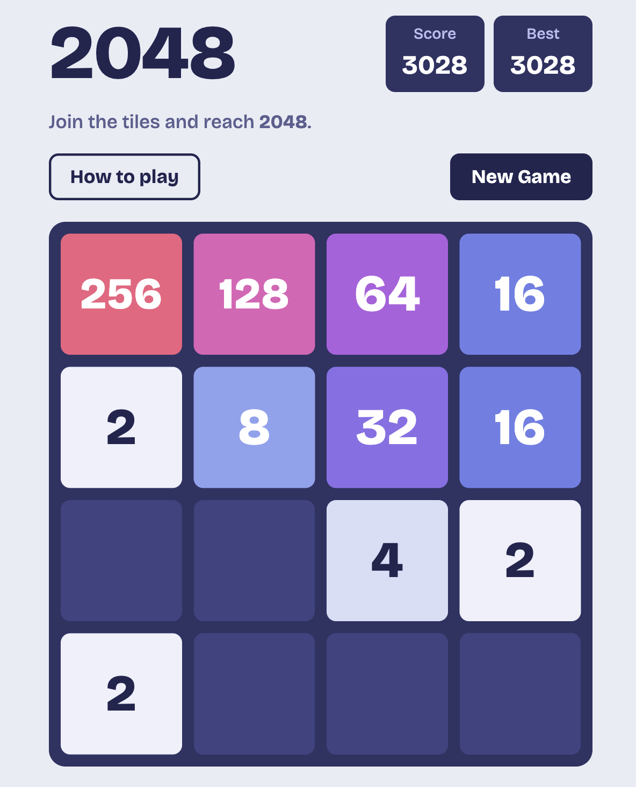

# 2048

A browser version of the classic number-merging puzzle. Slide the tiles, merge matching numbers, and try to reach **2048**.

**Play it here:** https://harshvaghasiya15.github.io/2048-GAME/





## Features

- Smooth tile sliding, popping, and merging animations
- Score and best score, with the best score saved between visits
- Your current game is saved automatically, so you can close the tab and continue later
- Works on computers and phones
- "Keep Going" option after reaching 2048
- Pop-up "How to play" guide

## How to play

- **PC:** use the arrow keys or the W A S D keys to move the tiles.
- **Mobile:** swipe on the board.
- When two tiles with the same number touch, they merge into one tile with double the value.
- After every move, a new 2 or 4 appears.
- The game ends when the board is full and no tiles can merge.

## Run it on your computer

No installation is needed. Download or clone this repository and open `index.html` in any modern browser.

## Project structure

```
├── index.html            Page structure
├── style.css             Layout, colors, and animations
├── script.js             Game logic and controls
└── terminal-version/     Original Python version
```

## Built with

HTML, CSS, and JavaScript (no libraries or frameworks).

## The terminal version

This project started as a Python game that runs in the terminal. The web version is a port of that logic to JavaScript with a new interface. The original code is kept in the [`terminal-version`](terminal-version) folder.

To run it, you need Python 3:

```bash
cd terminal-version
python main.py
```

Controls in the terminal version: `W` `A` `S` `D` to move, `Q` to quit, `R` to reset, `H` for help.
